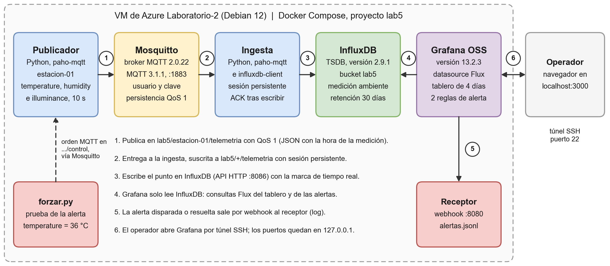

# Laboratorio 5: visualización y alertas con Grafana

Plataforma propia en la VM de Azure `Laboratorio-2`, levantada con Docker Compose:

- **Publicador.** Un publicador Python simula la estación ambiental que está junto al panel solar y publica tres variables cada 10 s por **MQTT**: `temperature` (°C), `humidity` (%) e `illuminance` (lux).
- **Broker.** Las lecturas llegan a **Mosquitto**.
- **Ingesta.** Un servicio de ingesta las guarda en **InfluxDB 2** (la TSDB) con la hora real en que se midieron.
- **Grafana OSS.** Es un servicio aparte que solo lee InfluxDB. Muestra el tablero de la toma de 4 días y evalúa las alertas.
- **Receptor de alertas.** Cuando una alerta se dispara o se resuelve, Grafana la envía por webhook a este receptor, que la guarda en un log.



## Protocolo elegido

**MQTT 3.1.1 con QoS 1** (Mosquitto 2.0.22). Se eligió por estas razones:

- Es el protocolo que ya usan el ESP32 y la VM desde el Laboratorio 2.
- Su modelo publicar/suscribir separa al sensor de quien guarda los datos.
- Con QoS 1, sesión persistente en la ingesta y persistencia en el broker, no se pierden lecturas aunque se reinicie el broker o la ingesta (probado: `evidencias/registros/prueba_resiliencia.log`).
- Mosquitto corre igual en la Raspberry Pi.

AMQP (RabbitMQ) pide más memoria para el mismo trabajo, y CoAP no tiene un broker publicar/suscribir equivalente.

## Contenido

```
docker-compose.yml           servicios: mosquitto, influxdb, publicador, ingesta, receptor-alertas, grafana
.env.example                 plantilla de variables (el .env real queda solo en la VM)
app/
  Dockerfile                 imagen común de los servicios Python (amd64 y arm64)
  publicador.py              estación simulada; publica por MQTT y acepta órdenes de forzado
  ingesta.py                 MQTT -> InfluxDB con ACK después de escribir
  receptor_alertas.py        recibe el webhook de Grafana y lo guarda en datos/alertas.jsonl
  forzar.py                  fuerza una variable unos minutos para disparar la alerta
  consultar.py               consulta la toma: inicio, fin, puntos, cobertura y huecos
mosquitto/                   configuración del broker y arranque con usuario y clave del .env
grafana/
  provisioning/              datasource, carpeta del tablero, reglas de alerta, webhook y política
  dashboards/lab5_estacion.json
scripts/
  instalar_vm.sh             instala Docker y crea 2 GB de swap
  generar_env.sh             crea el .env con claves aleatorias
  registrar_toma.sh          lo llama cron: registro diario y consulta final de los 4 días
  capturar_cierre.ps1        en el PC: captura el tablero de los 4 días al cerrar la toma
evidencias/                  capturas, registros y diagrama
Informe_Laboratorio_5.docx   informe
```

## Cómo levantar la VM

Probado en Debian 12 (VM de Azure con 1 GB de RAM). El script de instalación usa el repositorio oficial de Docker de la distribución, así que también contempla Ubuntu y Raspberry Pi OS de 64 bits.

1. Copiar la carpeta del laboratorio a la VM, por ejemplo en `~/laboratorio5`, y entrar en ella.
2. Instalar Docker y el swap:
   ```bash
   bash scripts/instalar_vm.sh
   ```
   Después, cerrar la sesión SSH y volver a entrar, para que el usuario quede en el grupo `docker`.
3. Crear el `.env` con claves aleatorias. Nunca se sube al repositorio:
   ```bash
   bash scripts/generar_env.sh
   ```
4. Levantar el stack:
   ```bash
   mkdir -p datos && docker compose up -d --build
   docker compose ps
   ```
   Los seis servicios deben quedar en `Up`; mosquitto e influxdb, en `healthy`. Todos tienen `restart: unless-stopped`, así que vuelven solos si la VM se reinicia.
5. Abrir Grafana desde el PC con un túnel SSH. Los puertos 3000, 8086 y 1883 solo escuchan en 127.0.0.1 de la VM, así que no hay que abrir nada en Azure. Primero, en una terminal del PC que quede abierta:
   ```bash
   ssh -N -L 3000:localhost:3000 -L 8086:localhost:8086 lab2@labo2.mexicocentral.cloudapp.azure.com
   ```
   Luego abrir `http://localhost:3000` en el navegador.

## Cómo funciona Grafana (guía rápida)

Grafana no guarda datos ni recibe los mensajes MQTT: **pregunta a una base de datos y dibuja lo que esta responde**. En este laboratorio esa base es InfluxDB.

| Pieza | Qué es | Dónde está en este proyecto |
|---|---|---|
| **Datasource** | La conexión de Grafana a una base de datos (dirección, organización y token). | `grafana/provisioning/datasources/influxdb.yml`: "InfluxDB lab5", lenguaje Flux. |
| **Dashboard (tablero)** | Una página con paneles y un rango de tiempo arriba a la derecha (por defecto, los últimos 4 días). | `grafana/dashboards/lab5_estacion.json`, en la carpeta "Laboratorio 5". |
| **Panel** | Un gráfico: serie de tiempo, medidor (gauge), número (stat), texto o lista de alertas. Cada panel tiene una consulta. | 12 paneles; el ícono (i) de cada uno explica qué muestra. |
| **Consulta Flux** | El lenguaje con que se le pide a InfluxDB: `from(bucket)` y luego `range`, `filter` y `aggregateWindow`. | Dentro de cada panel (menú del panel, opción Editar). |
| **Regla de alerta** | Una consulta que Grafana evalúa sola cada cierto tiempo y una condición sobre el resultado. | `grafana/provisioning/alerting/alertas.yml`, grupo "Umbrales de la estación". |
| **Punto de contacto** | A dónde se avisa: correo, Slack, webhook, etc. | "Receptor webhook (log)", que hace POST a `receptor-alertas:8080/alerta`. |
| **Política de notificación** | Qué alertas van a qué punto de contacto y cada cuánto se repiten. | Todas van al receptor; espera 10 s antes del primer aviso y repite cada 1 h. |

Todo está como archivos de **provisioning**: Grafana los lee al arrancar, así que el stack se reproduce igual en otra máquina sin hacer clics.

**Entrar y explorar**
- Sin iniciar sesión se ve todo como **Viewer** (solo lectura). Así puede leer el tablero un compañero de otro grupo.
- Para administrar, usar **Iniciar sesión** con el usuario `admin`. La clave está en el `.env` de la VM:
  ```bash
  grep GRAFANA_CLAVE ~/laboratorio5/.env
  ```
- **Rango de tiempo.** El selector de arriba a la derecha cambia el rango: "Últimos 4 días", "Últimos 30 minutos" o un rango absoluto. Arrastrar el mouse sobre un gráfico hace zoom.
- **Alertas.** Menú, luego Alertas y luego Reglas de alerta. Cada regla muestra su estado (Normal, Pendiente o Disparada), la consulta, la condición y su historial.
- **Cambiar un panel.** El tablero está provisionado y no se guarda desde la interfaz. Para practicar, usar "Guardar como copia". Para cambiarlo de verdad, se edita el JSON y se reinicia Grafana:
  ```bash
  docker compose restart grafana
  ```

### Alertas configuradas

| Regla | Condición | Ventana | Acción |
|---|---|---|---|
| Temperatura alta en la estación | Promedio de `temperature` > **32 °C** | Últimos 2 min, evaluada cada 30 s; debe sostenerse 1 min (pendiente) | Webhook al receptor (log `datos/alertas.jsonl`), y marca en el panel de temperatura |
| Toma sin datos de la estación | Ninguna lectura (consulta vacía) | Últimos 5 min, evaluada cada 30 s; pendiente 1 min | Webhook al receptor; sirve para detectar huecos en la toma |

El escenario normal va de 18 a 30 °C, así que 32 °C solo se alcanza forzando el valor.

## Disparar la alerta desde el publicador

```bash
docker compose exec publicador python forzar.py temperature 36 --minutos 6
docker compose logs -f receptor-alertas
```

Así transcurre la prueba:
1. El publicador envía 36 °C durante 6 minutos (en su log aparece `FORZADO`).
2. Hacia el minuto 1 la regla pasa a **Pendiente**, y un minuto después a **Disparada**. El receptor registra `FIRING`.
3. Al terminar el forzado vuelve a **Normal** y el receptor registra `RESOLVED`.

## Consultar la toma (TSDB)

```bash
docker compose exec ingesta python consultar.py
docker compose exec ingesta python consultar.py --desde=2026-10-10T18:52:29Z --hasta=2026-10-14T18:52:29Z
```

El script muestra:
- el inicio y el fin de la toma;
- los puntos guardados frente a los esperados;
- los huecos de más de 30 s;
- las últimas lecturas.

También se puede consultar InfluxDB directamente:

```bash
docker compose exec influxdb influx query 'from(bucket: "lab5") |> range(start: -1m) |> filter(fn: (r) => r._measurement == "ambiente")'
```

## Ventana de 4 días

- **Inicio de la toma oficial:** 2026-10-10 13:52:29 (hora de Colombia), es decir, 18:52:29 UTC. Antes de ese momento se hicieron las pruebas de instalación y de resiliencia, y esos puntos se borraron del bucket (`evidencias/registros/inicio_toma.log`).
- **Fin:** 2026-10-14 13:52:29 (hora de Colombia).
- **Tareas de cron en la VM:**
  - todos los días a las 23:59 de Colombia se agrega el estado de la toma a `evidencias/registros/toma_diaria.log`;
  - el 14 de octubre a las 13:55 se guarda la consulta final en `evidencias/registros/consulta_4_dias.txt`.
- **Huecos:** se ven como barras bajas en "Mensajes guardados por hora" y como cortes en las series. La regla "Toma sin datos" avisa si pasan 5 minutos sin lecturas.
- **Al cerrar la toma,** con el túnel abierto, ejecutar en el PC:
  ```powershell
  powershell -ExecutionPolicy Bypass -File scripts\capturar_cierre.ps1
  ```
  El script guarda `evidencias/capturas/15_tablero_4_dias.png` y trae de la VM la consulta final y el registro diario.
- **Resultado:** 34560 de 34560 puntos esperados a 10 s (100,00 %), sin huecos mayores a 30 s; además quedaron 36 puntos forzados por la prueba de la alerta (`evidencias/registros/consulta_4_dias.txt`).

## Operación

```bash
docker compose ps                         # estado de los servicios
docker compose logs -f ingesta            # ver lo que entra a InfluxDB
docker compose restart grafana            # aplicar cambios del tablero o de las alertas
docker compose down                       # detener sin borrar datos
```

Los datos quedan en los volúmenes `lab5_influxdb_datos`, `lab5_grafana_datos` y `lab5_mosquitto_datos`. `docker compose down -v` los borra, así que no conviene usarlo durante la toma.

## Migración a la Raspberry Pi

Todas las imágenes tienen versión para arm64: eclipse-mosquitto, influxdb, grafana y python slim. En la Pi basta con repetir los pasos de "Cómo levantar la VM". Si un ESP32 va a publicar directamente, hay que publicar el puerto 1883 en la red local (quitar `127.0.0.1:` en `docker-compose.yml`) y usar el usuario MQTT del `.env`.

## Secretos

- El `.env` (claves de MQTT, InfluxDB y Grafana, y el token de InfluxDB) solo existe en la VM, con permisos 600, y está en `.gitignore`.
- El repositorio lleva únicamente `.env.example` con valores de relleno.
- Los registros de `evidencias/` se revisaron para confirmar que no contienen ninguna de esas claves.

## Evidencias

| Archivo | Qué muestra |
|---|---|
| `capturas/01_instalacion_docker.png` | Docker 29.9 y Compose v5.6 instalados, el error de `swapon` y el swap de 2 GB activo |
| `capturas/02_stack_corriendo.png` | Los seis servicios arriba y la memoria que usa cada uno |
| `capturas/03_mqtt_publicador_ingesta.png` | Mensajes MQTT en `lab5/estacion-01/telemetria` con las tres variables, y los logs del publicador y de la ingesta |
| `capturas/04_consulta_tsdb.png` | Consulta de los puntos guardados en InfluxDB |
| `capturas/05_tablero_grafana.png` | Tablero al inicio de la toma |
| `capturas/06_forzar_temperatura.png` | Orden de forzado a 36 °C desde el publicador |
| `capturas/07_tablero_alerta_disparada.png` | Tablero con la temperatura sobre el umbral y la alerta en Firing |
| `capturas/08_regla_alerta_disparada.png` | Instancia de la regla en estado Alerting |
| `capturas/09_webhook_alerta_firing.png` | Notificación FIRING recibida por el webhook |
| `capturas/10_regla_condicion_y_ventana.png` | Consulta, ventana de 2 min, reducción y umbral de la regla |
| `capturas/11_webhook_firing_y_resolved.png` | FIRING y RESOLVED en el receptor |
| `capturas/12_tablero_alerta_resuelta.png` | Tablero después de la prueba, con las marcas Pendiente, Disparada y Normal |
| `capturas/13_historial_alerta.png` | Historial de estados de la regla |
| `capturas/14_tablero_ventana_al_corte.png` | Tablero desde el inicio de la toma hasta la fecha de corte del informe |
| `capturas/15_tablero_4_dias.png` | Tablero con los 4 días completos (se genera al cerrar la toma) |
| `registros/` | Instalación, `docker compose up`, prueba de resiliencia, inicio de la toma, alertas recibidas (JSON), consulta a la fecha de corte y registro diario |
