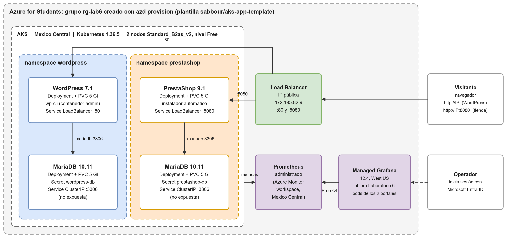

# Laboratorio 6: multiplataforma en AKS

Un solo clúster de **Azure Kubernetes Service** aloja dos portales independientes, cada uno con su propia base de datos:

| Portal | Namespace | Imagen | Base de datos | Acceso |
|---|---|---|---|---|
| WordPress | `wordpress` | `wordpress:7.1-php8.3-apache` | MariaDB 10.11 propia (Secret, PVC de 5 Gi, Service ClusterIP) | Service LoadBalancer, puerto 80 |
| PrestaShop | `prestashop` | `prestashop/prestashop:9.1-apache` | Otra MariaDB 10.11, con otro Secret y otro PVC | Service LoadBalancer, puerto 8080 |

**Azure Managed Grafana**, creado por la misma plantilla, observa el clúster por medio de Prometheus administrado. No toca las bases de datos de los portales.



## Contenido

```
azure.yaml                     proyecto azd (azd init -t https://github.com/sabbour/aks-app-template)
infra/                         Bicep de la plantilla, ajustado a Azure for Students (ver "Cambios")
k8s/
  wordpress/                   namespace, MariaDB (PVC + Deployment + Service ClusterIP) y WordPress
  prestashop/                  namespace, MariaDB, Service LoadBalancer y PrestaShop
  secretos-ejemplo/            forma de los Secrets, sin valores reales (no se aplican)
grafana/tablero_portales.json  tablero "Laboratorio 6 - WordPress y PrestaShop en AKS"
scripts/
  crear_secretos.sh            crea los Secrets con claves aleatorias (no las imprime)
  desplegar.sh                 despliega las dos bases de datos y los dos portales
  instalar_portales.sh         instala WordPress con wp-cli y crea la página y el producto de prueba
  producto_prueba.php          crea el producto de prueba con las clases de PrestaShop
  verificar_contenido.sh       muestra los pods y busca la página y el producto en su BD y en su sitio
  reiniciar_portales.sh        reinicia los dos Deployments y vuelve a verificar
evidencias/                    capturas, registros y diagrama
Informe_Laboratorio_6.docx     informe
```

## Requisitos

- Una suscripción de Azure. Aquí se usó Azure for Students.
- Azure CLI, azd, kubectl y jq. En una VM Debian 12 se instalan desde los repositorios `apt` de Microsoft; azd se instala desde el paquete `.deb` oficial de su release en GitHub.
- No hace falta Docker: los portales usan imágenes públicas de Docker Hub.

## Cómo desplegar

```bash
# 1. Iniciar sesión (código de dispositivo) y hacer que azd use la sesión de az
az login --use-device-code
azd config set auth.useAzCliAuth true

# 2. Clúster, Prometheus y Grafana con la plantilla (8 a 9 minutos)
azd env new lab6
azd env set AZURE_LOCATION mexicocentral
azd provision

# 3. Bases de datos y portales (unos 10 minutos; PrestaShop se instala sola al arrancar)
bash scripts/desplegar.sh

# 4. Instalación de WordPress y contenido de prueba
bash scripts/instalar_portales.sh

# 5. Prueba de persistencia: reinicia los dos Deployments y verifica
bash scripts/reiniciar_portales.sh

# 6. Tablero de Grafana
az extension add --name amg
az grafana folder create -g rg-lab6 -n <grafana> --title "Laboratorio 6"
az grafana dashboard create -g rg-lab6 -n <grafana> --folder "Laboratorio 6" --definition @grafana/tablero_portales.json --overwrite true

# 7. Apagado: borra el grupo de recursos completo
azd down --force --purge
```

`azd env get-values` muestra el nombre del clúster, el de Grafana (`AZURE_MANAGED_GRAFANA_NAME`) y la URL de Grafana (`AZURE_MANAGED_GRAFANA_ENDPOINT`). A Grafana se entra con la misma cuenta de Microsoft: la plantilla le da el rol **Grafana Admin** a quien ejecuta `azd provision`.

**Credenciales:**
- Ningún YAML del repositorio tiene claves. `crear_secretos.sh` las genera al azar y las guarda solo en el clúster.
- Para ver la clave del administrador de WordPress:
  ```bash
  kubectl get secret wordpress-admin -n wordpress -o jsonpath='{.data.WP_ADMIN_PASSWORD}' | base64 -d
  ```
- PrestaShop guarda la suya en `prestashop-admin`.
- El panel de PrestaShop queda en una carpeta con nombre aleatorio. Se ve con:
  ```bash
  kubectl exec deploy/prestashop -n prestashop -- ls -d /var/www/html/admin*
  ```

## Cómo se cumple cada punto de la guía

| Requisito | Cómo quedó |
|---|---|
| AKS y Grafana con la plantilla azd | `azd init -t sabbour/aks-app-template` y `azd provision`. Se crean AKS 1.36.5 en Mexico Central, Prometheus administrado y Azure Managed Grafana. |
| Dos portales en el mismo clúster | Namespaces `wordpress` y `prestashop`, cada uno con su Deployment, su PVC y su Service LoadBalancer. |
| Una BD por portal | Dos MariaDB distintas: cada una con su Secret, su PVC, su Deployment y su Service ClusterIP. Cada portal apunta a `mariadb` dentro de su propio namespace, así que ninguno puede llegar a la BD del otro por ese nombre. |
| Ninguna BD expuesta | Las dos son Services ClusterIP. Solo los portales son LoadBalancer. |
| Credenciales en Secrets | `crear_secretos.sh`. En el repositorio solo está `k8s/secretos-ejemplo/`, con valores `CAMBIAR`. |
| Asistentes de instalación | WordPress se instaló con `wp core install`, que hace lo mismo que el asistente web. PrestaShop se instaló con su instalador por línea de comandos (`PS_INSTALL_AUTO=1`). Así el despliegue se puede repetir sin clics. |
| Cambio que sobrevive al reinicio | Página "Pagina de prueba Laboratorio 6" y producto "Producto de prueba Laboratorio 6". `reiniciar_portales.sh` crea pods nuevos y ambos siguen en su BD y en su sitio. |
| Grafana con los pods de los dos portales | Tablero `lab6-portales`: pods en ejecución por portal, tabla de pods, CPU, memoria y pods vivos en el tiempo, con WordPress en azul y PrestaShop en naranja. |
| Apagado y costo | `azd down --force --purge` al terminar. El costo está en el informe. |

## Cambios respecto a la plantilla

La plantilla original (2023) no se puede desplegar tal cual en una suscripción Azure for Students de 2026. Se cambió lo mínimo:

| Plantilla original | Ahora | Por qué |
|---|---|---|
| 3 nodos de sistema + 1 de trabajo `Standard_DS4_v2` (32 vCPU), con autoescalado | 2 nodos `Standard_B2as_v2` (4 vCPU), fijos | La cuota es de 6 vCPU por región, y en Mexico Central la suscripción solo permite las series B v2 y D v4 o posteriores. Es el "SKU económico" que pide la guía. |
| AKS nivel Standard | Nivel Free | Sin costo por el plano de control. |
| Kubernetes 1.26 | 1.36 (la versión predeterminada de AKS) | La 1.26 ya no se puede crear. |
| APIs en vista previa de 2021 a 2023 | APIs GA (AKS 2024-09-01, Monitor 2023-04-03, Grafana 2023-09-01) | Las vistas previas antiguas se retiran. |
| Grafana en la misma región que el clúster | Grafana en West US | Azure Managed Grafana no existe en Mexico Central. Prometheus sí queda en Mexico Central. |
| Disco efímero del sistema operativo | Disco administrado de 64 GB | Los discos efímeros no caben en VMs de 2 vCPU. |
| ACR Standard | ACR Basic | Los portales usan imágenes públicas. |
| KEDA, Azure Service Operator, VPA, Azure Policy, Key Vault CSI y enrutamiento de aplicaciones | Se quitaron | El laboratorio no los usa. ASO, además, recibía el rol Contributor sobre toda la suscripción. |
| Sin rol de Grafana para el usuario | Rol Grafana Admin para quien ejecuta azd | Sin ese rol no se puede entrar a Grafana. |
| Hooks `preprovision` y `predeploy` | `preprovision` solo registra los proveedores; `predeploy` se quitó | Los portales se despliegan con kubectl. |

**Una sola IP pública.**
- Azure for Students permite **3 IP públicas por región**. En Mexico Central ya estaban ocupadas por la VM de trabajo, por la IP de salida del clúster y por otra VM de la suscripción.
- Por eso los dos Services LoadBalancer comparten la IP pública del balanceador del clúster, con la anotación `service.beta.kubernetes.io/azure-pip-name` que agrega `desplegar.sh`.
- WordPress queda en el puerto 80 y PrestaShop en el 8080. Cada portal sigue teniendo su propio Service LoadBalancer.

## Evidencias

| Archivo | Qué muestra |
|---|---|
| `capturas/01_azd_provision_y_nodos.png` | `azd provision` exitoso, versión, región, nivel y nodos en Ready |
| `capturas/02_bases_de_datos.png` | Las dos MariaDB en Running, sus PVC en Bound, sus Services ClusterIP y sus Secrets (solo los nombres) |
| `capturas/03_portales_y_servicios.png` | Deployments, Services LoadBalancer con la IP compartida, la BD de cada portal y los cuatro PVC |
| `capturas/04_reinicio_portales.png` | Pods antes y después del reinicio; la página y el producto siguen en su BD y en su sitio |
| `capturas/05` a `08` | La página de WordPress y el producto de PrestaShop, antes y después del reinicio |
| `capturas/09_prestashop_inicio.png` | Página de inicio de la tienda |
| `capturas/10` y `11` | Grafana: tablero de los dos portales |
| `capturas/12_azd_down.png` | Apagado del entorno |
| `registros/` | Instalación de herramientas, `azd init`, vista previa y `azd provision`, despliegue, instalación de los portales, reinicio y apagado |
